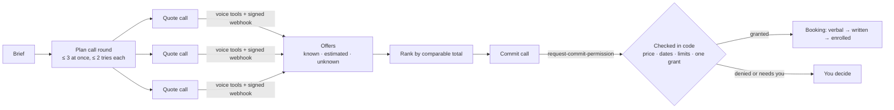

# Booker


AI-generated artwork; see [image provenance and terms](docs/images/README.md).

[](https://github.com/ogarciarevett/booker/actions/workflows/ci.yml)
[](LICENSE)


**Booker makes the phone calls you keep putting off.** It calls several providers, asks the same questions, compares the quotes, and books the one that fits your rules — checking price, dates, and limits in code *during* the call, before anyone says "yes".

Each request is an *errand*, described as data. Two seats in an intensive driving course and a dinner table for four run through the same code with a different brief.

> [!IMPORTANT]
> **Status: early development.** The domain core and voice tools run end to end in simulation. The ElevenLabs and Twilio live-call adapter and local dashboard are implemented; live use needs owner configuration and approval. The full automated errand workflow and Pipecat fallback remain on the [roadmap](#roadmap).

## Environment variables

Checks and simulations require no credentials. The complete [`.env.example`](.env.example) leaves every value empty, so optional defaults apply until you configure a feature. Keep credentials in 1Password and use the macOS Keychain as the local cache. Personal names, numbers, voice identifiers and infrastructure addresses belong in ignored local configuration.

`pnpm booker` loads the root `.env`; shell values take precedence, then saved dashboard settings apply when a value is unset. Empty values count as unset. Most settings apply at the next use; binding and tracing changes need a restart. See [settings](docs/settings.md) and [live calls](docs/live-calls.md). The dashboard runs in `apps/dashboard`: export its three overrides in the launching shell, since it does not load the root `.env` automatically.

| Name | Required for | Where to get it | Default |
| --- | --- | --- | --- |
| `BOOKER_OWNER_NAME` | Live calls: named owner in disclosure | Owner supplied name, kept locally | Unset |
| `PUBLIC_BASE_URL` | Agent setup: public tool and webhook URLs | Owner configured Tailscale Funnel HTTPS URL | Unset |
| `ELEVENLABS_API_KEY` | Agent setup, phone import, live calls and reconciliation | ElevenLabs workspace API keys, stored in 1Password | Unset |
| `ELEVENLABS_WEBHOOK_SECRET` | Signed webhooks and live call readiness | ElevenLabs post-call webhook signing secret, stored in 1Password | Unset; fallback to `.local/secrets/elevenlabs-webhook-secret` |
| `ELEVENLABS_VOICE_ID` | Agent setup: consented owner voice | ElevenLabs voice library after consent and verification | Unset |
| `BOOKER_AGENT_SCRIPT` | Agent sync: selects the script and a separate agent pair for custom paths | Dashboard or shell; repository-relative YAML path | `locales/es-ES/agent.yaml` |
| `TWILIO_ACCOUNT_SID` | Phone import and ending calls | Twilio account console, stored in 1Password | Unset |
| `TWILIO_AUTH_TOKEN` | Phone import and ending calls | Twilio account console, stored in 1Password | Unset |
| `TWILIO_PHONE_NUMBER` | Phone import: outbound number | Owned Twilio number, E.164, kept locally | Unset |
| `TYPESAFE_API_KEY` | Optional Jev routing in `pnpm route-task` | TypeSafe account API key, stored in 1Password | Unset; conservative default row |
| `TYPESAFE_BASE_URL` | Optional Jev endpoint override | TypeSafe deployment configuration | `https://api.typesafe.ai` |
| `OPENAI_API_KEY` | Future OpenAI model profile; currently unused | OpenAI project API keys, stored in 1Password | Unset |
| `ANTHROPIC_API_KEY` | Future Anthropic model profile; currently unused | Anthropic console API keys, stored in 1Password | Unset |
| `GEMINI_API_KEY` | Future Gemini model profile; currently unused | Google AI Studio API keys, stored in 1Password | Unset |
| `BOOKER_HOST` | Server binding; environment only | Local configuration, loopback only | `127.0.0.1` |
| `BOOKER_PORT` | Server and call client | Local configuration, integer from 1 to 65535 | `8787` |
| `BOOKER_DATA_DIR` | Database location; environment only | Local configuration, relative to repository or absolute | `.local/data` |
| `BOOKER_URL` | Dashboard connection to Booker | Local server URL; match its port | `http://127.0.0.1:8787` |
| `BOOKER_REPO_ROOT` | Dashboard control token lookup | Absolute path to the checkout holding `.local/secrets/control-token` | Two directories above dashboard working directory |
| `PHOENIX_URL` | Dashboard links to local traces | Local Phoenix URL | `http://127.0.0.1:6006` |
| `OTEL_EXPORTER_OTLP_TRACES_ENDPOINT` | Optional traces with `pnpm serve:traced` | Local Phoenix receiver: `http://127.0.0.1:6006/v1/traces` | Unset; tracing off |
| `OTEL_SERVICE_NAME` | Trace service and Phoenix project name | Local configuration | `booker` |
| `OTEL_SDK_DISABLED` | Explicit tracing disable switch | Local configuration, `true` or `false` | Unset; endpoint decides |
| `NODE_ENV` | Node and Next.js runtime mode | Runtime launcher | Development for dev; production for build and start |
| `PORT` | Dashboard request guard; managed by Next.js | Next.js sets it from the launcher port argument | `3100` in `pnpm dashboard` |
| `NEXT_TELEMETRY_DISABLED` | Next.js telemetry switch; managed | Dashboard launcher forces it | `1` |
| `PHOENIX_HOST` | Phoenix binding; managed | `pnpm phoenix` forces loopback | `127.0.0.1` |
| `PHOENIX_PORT` | Phoenix UI and OTLP receiver; managed | `pnpm phoenix` forces the port | `6006` |
| `PHOENIX_WORKING_DIR` | Phoenix storage; managed | `pnpm phoenix` forces local storage | `<repo>/.local/phoenix` |
| `PHOENIX_TELEMETRY_ENABLED` | Phoenix telemetry switch; managed | `pnpm phoenix` forces telemetry off | `false` |

## Quick start

You need **Node.js 24+**, **[pnpm](https://pnpm.io/)**, and **[gitleaks](https://github.com/gitleaks/gitleaks#installing) 8.30.1** (the version CI pins) on your `PATH`; the git hooks scan every commit for secrets.

```bash
git clone https://github.com/ogarciarevett/booker.git
cd booker
pnpm install                         # dependencies + git hooks
pnpm check                           # lint, typecheck, tests, and export privacy scan
```

### Watch a whole errand run

```bash
pnpm simulate
```

This runs six scripted scenarios end to end — call planning, the voice tools over HTTP, the signed post-call webhook, offer ranking, and the in-call commit check — once with in-memory stores and once with SQLite, with the additional fictional demo fixture, so you get fourteen passing tests. Abridged output:

```text
✓ tests/scenarios/driving-school.test.ts > driving-school errand end to end with in-memory stores > quotes both providers, ranks the fully confirmed one first, then books it verbally
✓ tests/scenarios/driving-school.test.ts > driving-school errand end to end with SQLite stores sharing one database > quotes both providers, ranks the fully confirmed one first, then books it verbally
✓ tests/scenarios/injection.test.ts > a provider trying to inject a new budget with in-memory stores > rejects every attempt to record a budget field, leaving the errand and the offer untouched
…

 Test Files  6 passed (6)
      Tests  14 passed (14)
```

| Scenario | What it proves |
|----------|----------------|
| `driving-school` | The happy path: parallel quotes, ranking, one verbal booking |
| `restaurant` | A different errand needs a different brief, not different code |
| `injection` | Nothing a provider says can change your budget or permissions |
| `misheard-price` | The agent cannot commit to a price that differs from the confirmed offer |
| `quote-call-cannot-commit` | Quote calls never see the booking tools |
| `busy-provider` | Retries are capped per provider |

The scenarios live in [`tests/scenarios/`](tests/scenarios/), the scripted providers in [`simulations/personas.ts`](simulations/personas.ts), and the example briefs (fictional providers, `+1 555 01xx` numbers) in [`examples/errands/`](examples/errands/).

See [the 90-second demo plan](docs/demo.md) for a fictional errand and a recording script. A real phone recording requires a separate owner yes.

### Route a development task

```bash
pnpm route-task "add an ElevenLabs outbound-call adapter"
```

Picks a row from the [agent matrix](docs/agent-matrix.md) and prints the Orca command that would start a worker for it. It never runs the command. With `TYPESAFE_API_KEY` set, Jev chooses the row; without it, you get the default row.

## How it works



1. **Brief.** You describe the errand: what, when, for whom, and your limits.
2. **Quote calls.** A voice agent calls up to three providers at once and records each answer with its verbatim evidence. Quote calls cannot book anything.
3. **Compare.** Offers are filtered by hard requirements, then ranked by comparable total cost. Unknowns stay unknown; estimates are marked as estimates.
4. **Commit.** One call gets the right to book. Before the agent says a binding "yes", the backend checks the price, dates, deposit, limits, and exclusivity *during* the call. Change the offer and the permission is revoked.
5. **Verify.** A verbal booking, the written confirmation, and the completed enrollment are tracked separately.

Every voice runtime talks to the same small HTTP contract, so swapping the voice provider is configuration, not a rewrite:

| Route | Purpose |
|-------|---------|
| `POST /voice-tools/:callId/get-errand-context` | Only what a provider may hear: objective, dates, questions, shareable details |
| `POST /voice-tools/:callId/record-quote-field` | Write one offer field, with evidence; nothing else is writable |
| `POST /voice-tools/:callId/request-commit-permission` | The in-call check; commit calls only |
| `POST /voice-tools/:callId/report-commit-outcome` | Record the provider's answer; commit calls only |
| `POST /webhooks/elevenlabs/post-call` | Signed transcript and call status, processed exactly once |

Details: [docs/architecture.md](docs/architecture.md).

## Voice engines

| Engine | Role | Voice |
|--------|------|-------|
| **ElevenLabs Agents** + Twilio | Primary runtime | Your own consented voice clone with `eleven_v4_turbo` and audio tags (`[laughs]`, `[sighs]`). An external TTS cannot be plugged in here. |
| **Pipecat** + Twilio Media Streams | Plan B, tier 1 | Same ElevenLabs clone, our own conversation loop |
| **Pipecat** + Gemini | Plan B, tier 2 (ElevenLabs fully down) | `gemini-3.8-flash-tts` with a stock Spanish voice (Gemini voice cloning is likely unavailable in Spain and the EEA) |

## Responsible use

| Rule | What it means |
|------|---------------|
| Your own voice only | Voice cloning uses the provider's consent and verification flow for your own voice. Never clone someone else. |
| Always disclosed | Every call opens by saying it is an AI assistant acting for a named person, plus a recording and processing notice ([ElevenLabs disclosure requirement](https://elevenlabs.io/docs/eleven-agents/legal/disclosure-requirement)). |
| Consent to continue | If the other party does not want to talk to an AI, the call ends and you are informed. |
| Personal data stays local | Real errands, participants, recordings, transcripts, and databases live in the ignored `.local/` directory and are never committed. |
| Code decides limits | Money, dates, permissions, and booking exclusivity are checked in code. Nothing a provider says can change your budget or permissions. |

## Using your Claude or ChatGPT subscription

Booker's offline reasoning (brief parsing, question planning, transcript extraction) runs through *model profiles*:

| Profile | Backed by | Intended use |
|---------|-----------|--------------|
| `claude-code` | Your local Claude Code login, via [`ai-sdk-provider-claude-code`](https://ai-sdk.dev/providers/community-providers/claude-code) | Personal, single-user, on your own machine |
| `codex-cli` | Your local Codex CLI login, via [`ai-sdk-provider-codex-cli`](https://ai-sdk.dev/v7/providers/community-providers/codex-cli) | Personal, single-user, on your own machine |
| `api` | A provider API key | Servers, parallel work, anything latency-bound |

> [!CAUTION]
> Anthropic's [legal and compliance page](https://code.claude.com/docs/en/legal-and-compliance) lists products built on the Agent SDK under API-key authentication and forbids routing requests through Free, Pro, or Max credentials on behalf of other users. The policy changed several times in 2026. Booker never offers "sign in with Claude" or "sign in with ChatGPT", and a kill switch moves every role to the `api` profile. Subscription profiles are never used inside a live call.

## Project layout

```text
src/
  shared/ errands/ offers/ policies/ bookings/   domain core (no frameworks)
  decisions/ reasoning/                          Jev decisions, runtime model matrix
  calls/                                         call lifecycle, tool contract, simulated voice runtime
  http/                                          Hono routes: voice tools, post-call webhook
  server/ cli/                                   the local server and `pnpm booker` commands
  observability/                                 opt-in OpenTelemetry tracing to a local Phoenix
  persistence/                                   Drizzle + SQLite stores and migrations
apps/dashboard/   Next.js dashboard: live calls, transcripts, offers, bookings (pnpm dashboard)
simulations/      scripted provider personas
examples/errands/ fictional example briefs
tests/scenarios/  end-to-end simulations
docs/             vision, architecture, agent matrix, agent skills
```

The domain folders import only `zod`, Node built-ins, and each other; [`tests/architecture.test.ts`](tests/architecture.test.ts) enforces it.

## Roadmap

- [x] Repository foundation: toolchain, CI, secret scanning, contributor docs
- [x] Errand core: briefs, offers, ranking, standing rules, commit grants, booking ledger, SQLite
- [x] Model matrix: Jev decisions with a conservative fallback, runtime and dev-agent matrices
- [x] Voice tool contract: authenticated tools, signed idempotent webhook, simulated calls
- [ ] Desktop control app (Tauri v2 + React) with a live call board and an API-key setup wizard
- [ ] Reasoning: model profiles and transcript-to-offer extraction
- [ ] Errand workflow with Mastra (suspend and resume on call results and approvals)
- [x] ElevenLabs live adapter: agent configuration as code, Spanish disclosure, local call control
- [ ] Owner approved first real call and pilot recording
- [ ] Control page and calendar check before booking
- [ ] Plan B with Pipecat, and a failover drill
- [ ] Pilot

## Documentation

| Document | Purpose |
|----------|---------|
| [docs/vision.md](docs/vision.md) | Product goals, the errand model, and booking rules |
| [docs/architecture.md](docs/architecture.md) | Components, modules, voice tool contract, safety invariants |
| [docs/live-calls.md](docs/live-calls.md) | Running the local server for real calls: what runs where, environment variables |
| [docs/observability.md](docs/observability.md) | Local traces in Arize Phoenix, the read-only data API, and the dashboard: starting them, what they show, privacy rules |
| [docs/agent-matrix.md](docs/agent-matrix.md) | Which coding agent and model handle which kind of task |
| [docs/agent-skills.md](docs/agent-skills.md) | Agent skills used in this repository and how to install them |
| [docs/public-readiness.md](docs/public-readiness.md) | Squashed-tree privacy gate and owner approval for public release |
| [CONTRIBUTING.md](CONTRIBUTING.md) | Setup, checks, commit and language policy |
| [SECURITY.md](SECURITY.md) | How to report a vulnerability |
| [AGENTS.md](AGENTS.md) | Instructions for AI coding agents |

## License

[Apache-2.0](LICENSE) applies to the code and documentation. The two generated images listed in [image provenance and terms](docs/images/README.md) are excluded from that grant and carry the applicable provider output terms.
